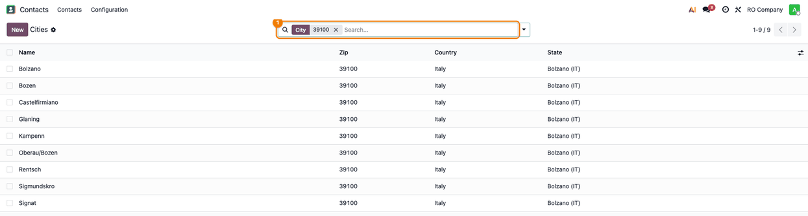
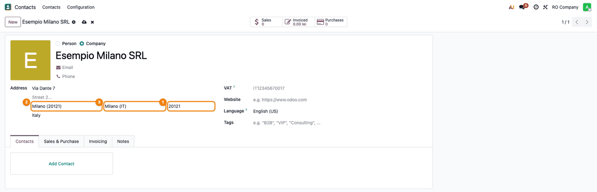
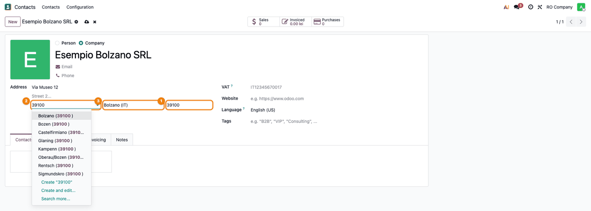
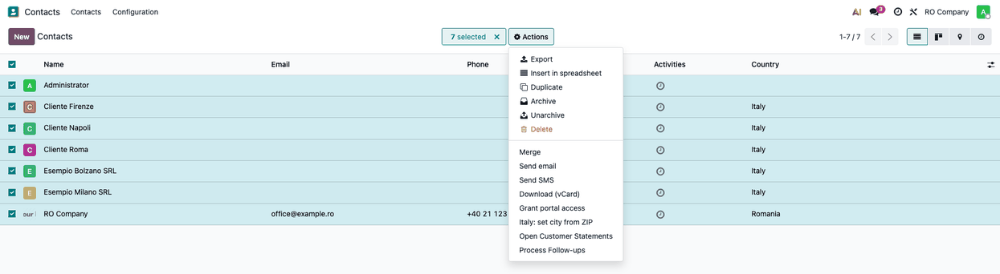
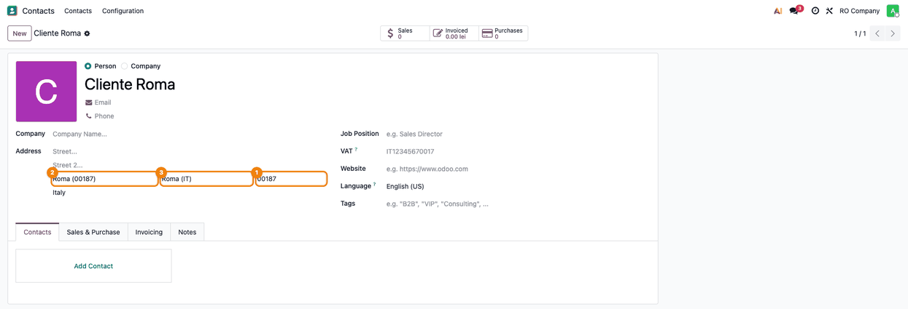

=====================
Italy - City from ZIP
=====================

..
   !!!!!!!!!!!!!!!!!!!!!!!!!!!!!!!!!!!!!!!!!!!!!!!!!!!!
   !! This file is generated by oca-gen-addon-readme !!
   !! changes will be overwritten.                   !!
   !!!!!!!!!!!!!!!!!!!!!!!!!!!!!!!!!!!!!!!!!!!!!!!!!!!!
   !! source digest: sha256:03114f07807ae31c612f2bdb660b55ccd77341506e1c83913b7e1df1c07fcb81
   !!!!!!!!!!!!!!!!!!!!!!!!!!!!!!!!!!!!!!!!!!!!!!!!!!!!

.. |badge1| image:: https://img.shields.io/badge/maturity-Beta-yellow.png
    :target: https://odoo-community.org/page/development-status
    :alt: Beta
.. |badge2| image:: https://img.shields.io/badge/license-LGPL--3-blue.png
    :target: http://www.gnu.org/licenses/lgpl-3.0-standalone.html
    :alt: License: LGPL-3
.. |badge3| image:: https://img.shields.io/badge/github-dhongu%2Fl10n--italy-lightgray.png?logo=github
    :target: https://github.com/dhongu/l10n-italy/tree/20.0/l10n_it_zip
    :alt: dhongu/l10n-italy

|badge1| |badge2| |badge3|

Loads the Italian localities with their postal code (CAP) and province,
and fills in the city and the province of Italian addresses from the
CAP.

- Ships the list of Italian localities (comuni and frazioni) with their
  CAP, linked to the provinces already defined in Odoo. The data comes
  from `GeoNames <https://www.geonames.org>`__ (Creative Commons
  Attribution 4.0).
- Italy is set to *enforce cities*: the city of an Italian address is
  chosen from the list.
- On the contact form, typing the CAP of an Italian address sets the
  city and the province. A CAP shared by several localities sets only
  the province; the city name, when it matches one of them (without
  accents and case), picks the locality. A leading zero lost in an
  import is put back ("187" is "00187").
- The action *Italy: set city from ZIP* on contacts links the Italian
  contacts to the city of their CAP and fills in the province.
- At install, the Italian contacts are linked: directly on a small
  database, by the scheduled action *Italy: link contacts to the city of
  their ZIP* in batches on a large one (it deactivates itself when
  done).
- Every form that runs the postal code rules of the contact (for example
  the delivery details of an AWB) gets the province filled in, so the
  shipment can be sent to Italy without looking up the province by hand.

**Table of contents**

.. contents::
   :local:

Usage
=====

1. As an administrator, open **Contacts → Configuration → Localization →
   Cities** and search for a CAP: the Italian localities of that postal
   code are listed with their province.

   |Cities list filtered on the CAP 39100: nine localities of the
   province Bolzano (IT)|

2. Open an Italian contact and type the CAP in the address: the city and
   the province are filled in.

   |Contact in Italy: the CAP 20121 fills in the city Milano (20121) and
   the state Milano (IT)|

3. When the CAP is shared by several localities, only the province is
   filled in; choose the city from the list (type the CAP or the name in
   the city field).

   |Contact in Italy: the CAP 39100 fills in the state Bolzano (IT); the
   city field lists the localities of 39100|

4. To complete existing or imported contacts, select them in the list
   and run *Actions → Italy: set city from ZIP*.

   |Contacts list with Italian contacts selected and the Actions menu
   open on Italy: set city from ZIP|

   |Contact Cliente Roma after the action: ZIP 00187, city Roma (00187)
   and state Roma (IT)|

Changelog
=========

19.0.1.0.1 (2026-11-04)
-----------------------

**Added**

- Italian translation (``i18n/it.po``) of the actions.

19.0.1.0.0 (2026-11-04)
-----------------------

**Added**

- Italian localities with postal code (CAP) and province, from GeoNames.
- City and province filled in from the CAP on Italian addresses; action
  and scheduled action to link the existing contacts.
- Consultant sheet (readme/FISA_CONSULTANT.md) and screenshots, in
  Romanian and English.

Bug Tracker
===========

Bugs are tracked on `Terrabit Issues <https://www.terrabit.ro/helpdesk>`_.
In case of trouble, please check there if your issue has already been reported.

Do not contact contributors directly about support or help with technical issues.

Credits
=======

Authors
-------

* Terrabit

Maintainers
-----------

.. |maintainer-dhongu| image:: https://github.com/dhongu.png?size=40px
    :target: https://github.com/dhongu
    :alt: dhongu

Current maintainer:

|maintainer-dhongu| 

This module is part of the `dhongu/l10n-italy <https://github.com/dhongu/l10n-italy/tree/20.0/l10n_it_zip>`_ project on GitHub.

You are welcome to contribute.